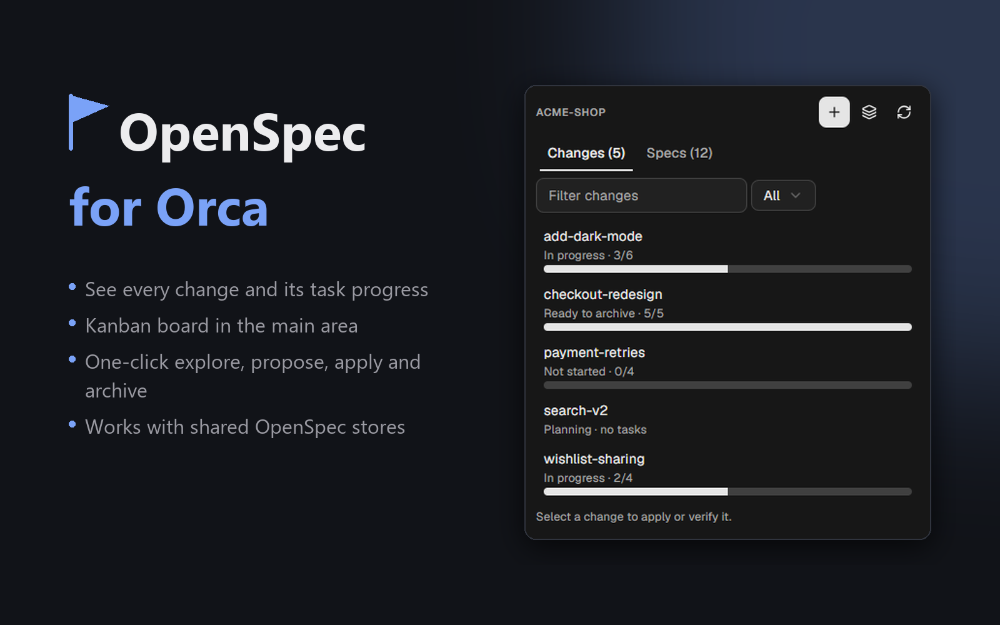
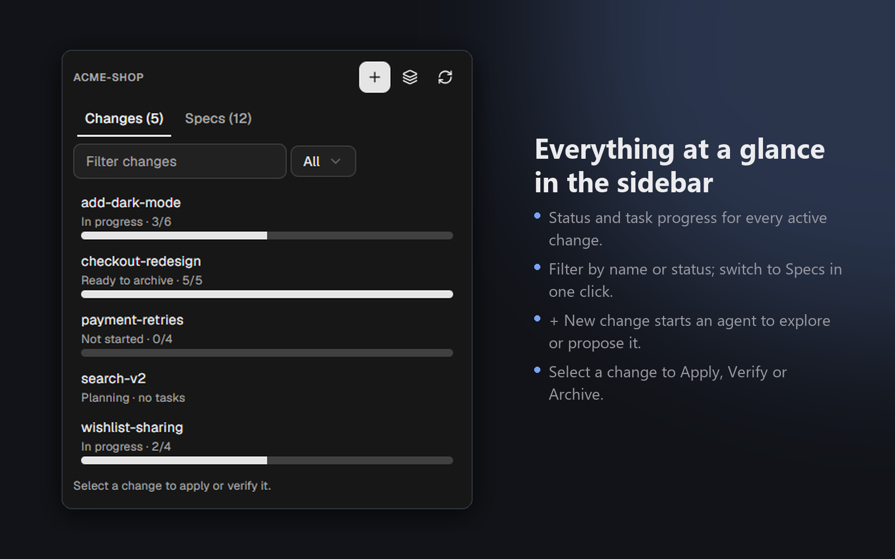
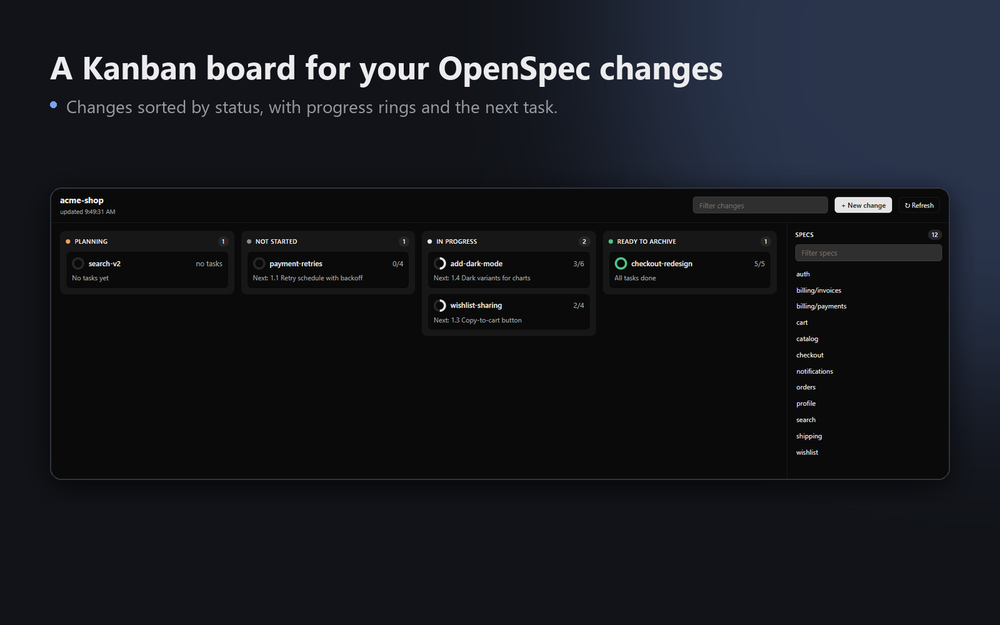
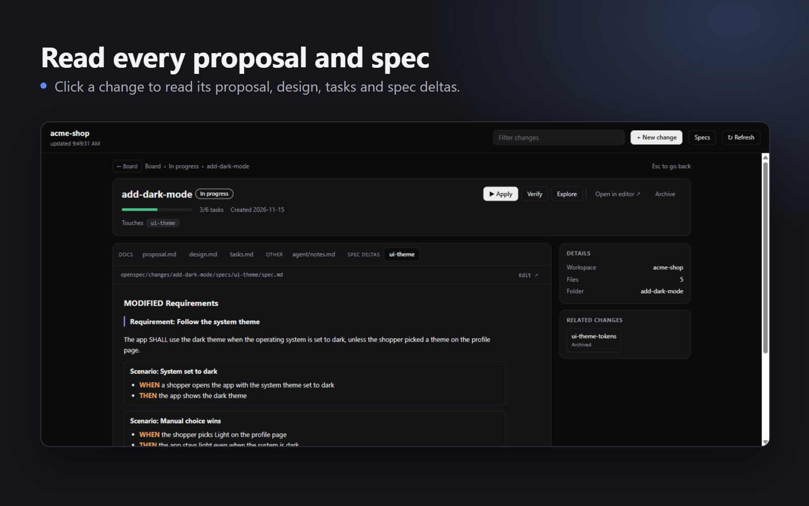
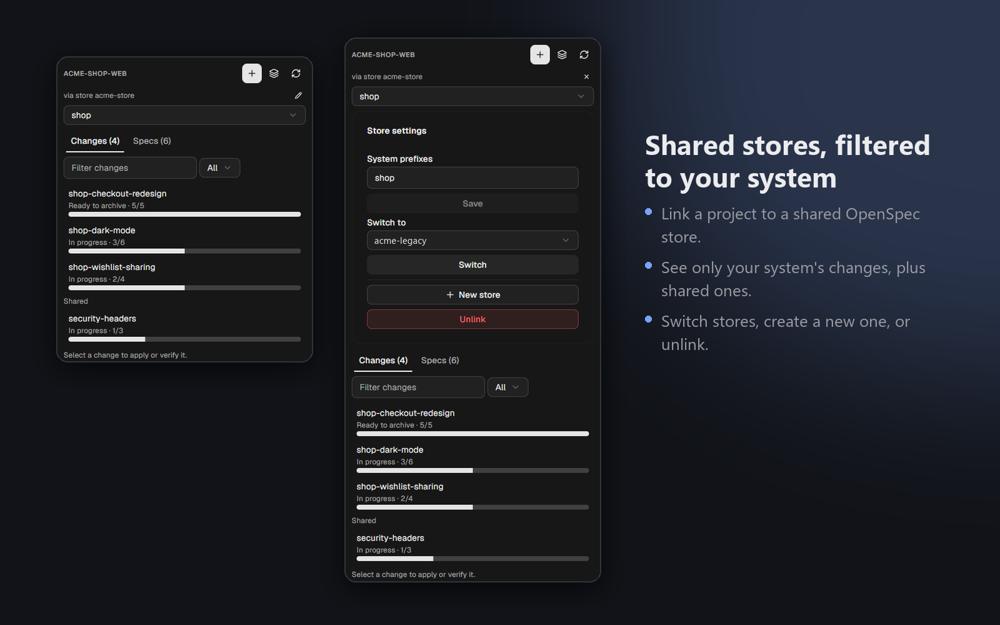

<div align="center">


<h1>Orca OpenSpec</h1>

<p>
<b>OpenSpec in Orca: your changes and specs in the sidebar, and agents one click away.</b><br>
An <a href="https://github.com/stablyai/orca">Orca</a> plugin for <a href="https://github.com/Fission-AI/OpenSpec">OpenSpec</a>. It shows a workspace's changes and specs (local or in a shared store), opens a Kanban board, and starts agents to explore, propose, apply, verify and archive changes.
</p>

<p>
<a href="LICENSE"></a>


</p>

<p>
<a href="#install">Install</a> ·
<a href="#the-sidebar-panel">Sidebar panel</a> ·
<a href="#the-board">Board</a> ·
<a href="#openspec-stores">Stores</a> ·
<a href="#requirements">Requirements</a> ·
<a href="#permissions-and-settings">Permissions and settings</a> ·
<a href="#limitations">Limitations</a> ·
<a href="#develop">Develop</a>
</p>



<p><sub>The OpenSpec panel in Orca's right sidebar.</sub></p>

</div>

## Install

Get it from the plugin page: **[orca.dev/plugins/jameslatajan/orca-openspec](https://orca.dev/plugins/jameslatajan/orca-openspec)**, or from a terminal:

```sh
orca plugin install jameslatajan/orca-openspec
```

Orca shows the access the plugin asks for ([below](#permissions-and-settings)) and installs it once you approve. Then open **OpenSpec** (the flag icon) in Orca's right sidebar. `orca plugin update` moves you to the newest release later.

> [!NOTE]
> Needs Orca 1.4.259 or newer, the `openspec` CLI (tested with 2.1.0) and an agent with the OpenSpec skills or slash commands installed (default: `claude`). Remote and SSH workspaces are not supported yet. See [Requirements](#requirements).

## The sidebar panel



- **Changes tab:** every active change in `openspec/changes/` as a compact row with a status (Planning, Not started, In progress, Ready to archive), a progress bar and the checked/total task count from its `tasks.md`. Filter by name, and narrow by status (All / In progress / Done) with the dropdown next to the filter box.
- **Specs tab:** every capability under `openspec/specs/`, including nested ones such as `billing/invoices`, with a name filter. Specs show in a table that loads 40 at a time as you scroll, so stores with hundreds of specs stay quick. The filter still searches all of them.
- **Actions:**
  - **+** (New change) in the header opens a form. Describe the change, pick an agent (claude, codex, gemini, opencode, cursor or copilot), then press **Explore** (`/openspec-explore <description>`) or **Propose** (`/openspec-propose <description>`). With **claude**, you can also pick a **Model** (Default, Opus, Sonnet or Haiku): the plugin types `/model <name>` before the command.
  - Every action opens the agent's terminal where you can see it. The plugin waits until the agent is ready, then types the command for you.
  - Selecting a change shows **Apply** and **Verify**. Once every task is done, **Archive** replaces Verify.
  - Apply, Verify and Archive start an agent in the current workspace with the matching OpenSpec command for the change: `/openspec-apply-change <change>`, `/openspec-verify-change <change>` or `/openspec-archive-change <change>`. If your agent has `/opsx:*` commands instead, set **Command style** to OPSX.
- **Palette commands:** `OpenSpec: New change`, `Apply change`, `Verify change`, `Archive change` and `Refresh panel`. Apply, Verify and Archive use the change selected in the panel, or the only change if there is just one.
- **Auto-refresh:** the panel updates about 300 ms after files in `openspec/` change, when you switch workspace, and when an agent the plugin started finishes.
- **Init OpenSpec:** in a workspace without an `openspec/` folder, a button opens a terminal running `openspec init`.

<br clear="right">

## The board





- **Board tab:** "OpenSpec: Open board" (palette) or the board button in the panel header opens a full-size Kanban board in the main area.
  - Columns: Planning, Not started, In progress, Ready to archive and Archived. Archived starts collapsed and loads 40 changes at a time as you scroll.
  - Cards show the first sentence of the proposal's Why, progress, the date and the next task. Hover a card for quick actions: Apply, Verify, or Archive once it's ready.
  - **Click a card** to open the change: its status and progress, the specs it touches, and tabs for `proposal.md`, `design.md`, `tasks.md`, any other notes in the change folder, and each spec delta, shown as formatted text. **Edit ↗** opens the file in Orca's editor. A side box lists related changes (active or archived) that touch the same specs. Archived changes open read-only.
  - **Specs** in the header opens a searchable list; click a spec to read it and see which changes touched it.
  - Apply, Verify and Explore start at once. **Archive** first asks, shows the command it will send, and warns when tasks are unfinished.
  - Go back with **← Board**, the breadcrumb, the title, or Esc.
  - It's backed by `openspec/board.openspec`, which is created on first open and added to `openspec/.gitignore`.

<br clear="right">

## OpenSpec stores



- **OpenSpec stores:** if a workspace's `openspec/config.yaml` says `store: <id>`, the panel shows that store's changes and specs (from the folder `openspec store list` registers for `<id>`), labels the header "via store <id>", and watches the store for edits. Press Refresh after registering or moving a store.
- **New store:** **New store** (on the "not set up" screen, or under Change store) runs `openspec store setup <id> --path <folder>`, which makes a new git repo with a first commit, then links the workspace to it. The folder defaults to `openspec-<id>` next to your project.
- **Change store:** in a store workspace, the pencil next to "via store …" opens **Store settings**: edit the system prefixes, **Switch** to another registered store, **Unlink**, or create a **New store**. Both edit only the `store:` line. Unlinking deletes `config.yaml` if that was all it held, and the panel then offers Init / Link store again. Workspaces with their own local OpenSpec can't switch.
- **Link to a store:** in a workspace without OpenSpec, the "not set up" screen also offers **Or use a store**: pick a registered store and press **Link store**. That creates `openspec/config.yaml` with just `store: <id>`, never overwriting an existing config. With no stores registered, the screen shows the `openspec store register <path>` command instead.
- **Scope (store workspaces):** a shared store can hold many systems' items. In a store workspace, the scope dropdown next to the store badge shows by default only the items whose name starts with your system's prefix (`claims-…`), then a **Shared** section for items with no common system prefix. The prefixes are guessed from the workspace name ("ACME CLAIMS" → `claims`); change them in Store settings, for example `claims, ess`. **All systems** shows everything.

<br clear="right">

## Requirements

- Orca 1.4.259 or newer
- The [`openspec` CLI](https://github.com/Fission-AI/OpenSpec), **2.1.0** (the version this plugin is built and tested with). It's used for Init OpenSpec and for stores: reading the store list, creating stores (`openspec store setup`), and resolving a workspace's `store:` line. Check yours with `openspec --version`.
- An agent with the OpenSpec skills or slash commands installed (default: `claude`)

| | Version |
| --- | --- |
| This plugin | 1.1.2 |
| OpenSpec CLI (tested) | 2.1.0 |
| Orca (minimum) | 1.4.259 |

## Permissions and settings

<details>
<summary><b>Permissions</b>: what the plugin's worker may do</summary>

The plugin runs a Node worker with your user account's access. It asks for:

| Capability | Used for |
| --- | --- |
| `workspace:read` | Finding the focused workspace and its path |
| `agent:read` | Refreshing when a launched agent finishes |
| `agent:launch` | Starting agents for OpenSpec commands |
| `terminal:send` | Running `openspec init`, and typing the OpenSpec command into the agent |
| `terminal:read` | Seeing when a new agent is ready for input |
| `workspace:write` | Showing the new agent's terminal |
| `notifications:show` | Telling you to select a change first |
| `storage:own`, `settings:own` | Remembering the selected change and the agent setting |

</details>

**Settings** (in Orca's plugin settings):

| Setting | Default | Meaning |
| --- | --- | --- |
| Agent | `claude` | Agent CLI launched for OpenSpec commands |
| Command style | Skill commands | `/openspec-propose`, `/openspec-apply-change <change>`, … (what `openspec init` installs for Claude Code), or OPSX: `/opsx:propose`, `/opsx:apply <change>`, … |

## Limitations

- Every agent gets the same slash command. Agents other than Claude Code may name or invoke OpenSpec commands differently.
- Remote and SSH workspaces are not supported yet; the panel says so.

## Develop

<details>
<summary>Run from a clone, project layout and tests</summary>

To work on the plugin, run it from a clone:

```sh
git clone https://github.com/jameslatajan/orca-openspec.git
cd orca-openspec
orca plugin dev watch .
```

The plugin needs no build step: Orca transpiles the TypeScript when it loads. With `dev watch` running, saving a file reloads it.

```
orca-plugin.json     manifest: panel, board editor, commands, events, settings, capabilities
src/worker.ts        reads openspec/, launches agents, watches for changes, manages stores
src/openspec.ts      parses changes, task checkboxes and specs (pure Node)
src/store.ts         store lookup, linking, creating and switching
src/view.ts          status, filter and system-prefix logic shared by panel and board
src/watch.ts         recursive, debounced folder watcher
src/panel.tsx        the sidebar panel (Orca components, TSX)
src/protocol.ts      typed panel <-> worker requests and events
board/main.ts        the Kanban board tab (plain DOM)
src/*.test.ts(x)     tests
openspec/            this project's own OpenSpec specs and archived changes
```

```sh
orca plugin test .       # worker and panel tests
orca plugin check .      # validate the manifest and render the panel
orca plugin validate .
```

This plugin is itself built with OpenSpec: see `openspec/specs/openspec-panel/spec.md` for the requirements, and `openspec/changes/archive/` for the changes that produced it.

</details>

## License

[Apache-2.0](LICENSE)
